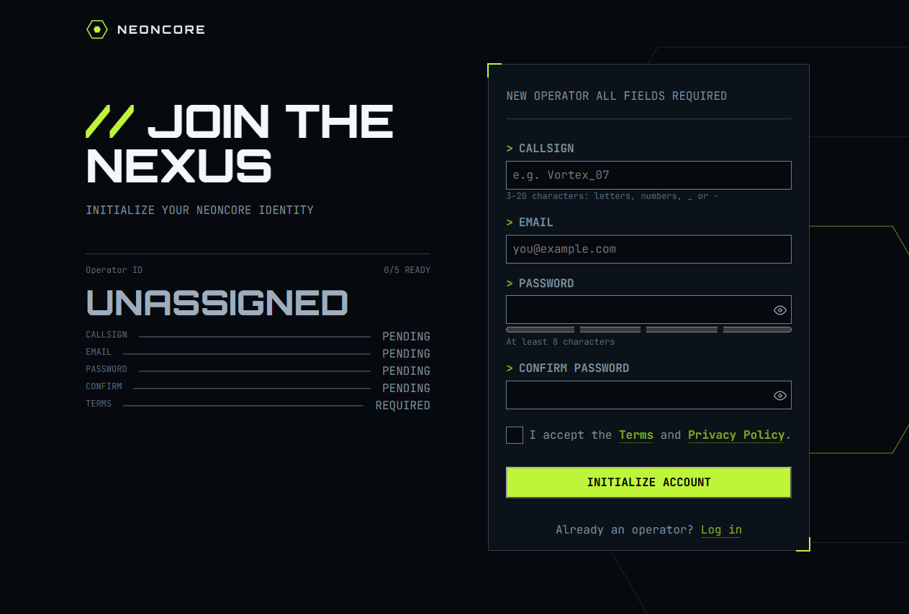

# Frontend Mentor - Gamer sign-up form solution

This is a solution to the [Gamer sign-up form challenge on Frontend Mentor](https://www.frontendmentor.io/challenges/gamer-sign-up-form). Frontend Mentor challenges help you improve your coding skills by building realistic projects.

## Table of contents

- [Overview](#overview)
  - [The challenge](#the-challenge)
  - [Screenshot](#screenshot)
  - [Links](#links)
- [My process](#my-process)
  - [Built with](#built-with)
  - [What I learned](#what-i-learned)
  - [Continued development](#continued-development)
  - [Useful resources](#useful-resources)
  - [AI Collaboration](#ai-collaboration)
- [Author](#author)
- [Acknowledgments](#acknowledgments)

## Overview

### The challenge

Users should be able to:

- Fill in the form with a callsign, email, password, and password confirmation, and accept the terms
- Receive form validation messages if any field is missed or filled in incorrectly
- Show and hide each password with the eye button
- See a password strength meter update as they type
- See a loading state on the button while the form submits, then a success message
- Complete the form only using their keyboard
- Have inputs, hints, error messages, and the success message announced on their screen reader
- View the optimal layout for the interface depending on their device's screen size
- See hover and focus states for all interactive elements on the page

### Screenshot



### Links

- Solution URL: [Github code](https://github.com/farazpc3/gamer-sign-up-form-frontend-mentor)
- Live Site URL: [Github page](https://farazpc3.github.io/gamer-sign-up-form-frontend-mentor)

## My process

### Built with

- Semantic HTML5 markup
- CSS custom properties
- Flexbox
- CSS Grid
- Mobile-first workflow
- Javascript

### What I learned

Incredible uses of ::before and ::after in CSS:

```
.form::before {
    content: "";
    position: absolute;
    top: -1px;
    left: -1px;
    width: 20px;
    height: 20px;
    border-top: 2px solid var(--color-lime-500);
    border-left: 2px solid var(--color-lime-500);
    pointer-events: none;
  }

  /* 2. Bottom-Right Corner */
  .form::after {
    content: "";
    position: absolute;
    bottom: -1px;
    right: -1px;
    width: 20px;
    height: 20px;
    border-bottom: 2px solid var(--color-lime-500);
    border-right: 2px solid var(--color-lime-500);
    pointer-events: none;
  }
```

and to use progress element for semantic html and using same ::before and ::after trick for the visuals.

```
  .form__password-strength {
    width: 100%;
    accent-color: var(--color-lime-500);
  }

  .form__password-strength::before {
    content: "";
    display: inline-block;
    position: relative;
    left: calc(25% - var(--progress-meter-gap) / 2);
    width: 25%;
    height: 100%;
    border-left: var(--progress-meter-gap) solid var(--color-neutral-900);
    border-right: var(--progress-meter-gap) solid var(--color-neutral-900);
  }
  .form__password-strength::after {
    content: "";
    display: inline-block;
    position: relative;
    left: calc(50% - var(--progress-meter-gap) / 2);
    width: 25%;
    height: 100%;
    border-left: var(--progress-meter-gap) solid var(--color-neutral-900);
  }
```

It was also my first time really practicing javascript and it was very educating.

### Continued development

I'd like to move on to React and Next from now on as I feel I might actually be able to handle it

### Useful resources

- [MDN](https://www.example.com) - the usual reference for HTML, CSS and Javascript.
- [Example resource 2](https://moderncss.dev/pure-css-custom-checkbox-style/) - This article helped me design checkbox inputs for this project

### AI Collaboration

I've used Deepseek for asking questions which I couldn't easily find answer for in my current resources.

- Website - [portfolio](https://farazcv.vercel.app)
- Frontend Mentor - [@farazpc3](https://www.frontendmentor.io/profile/farazpc3)

